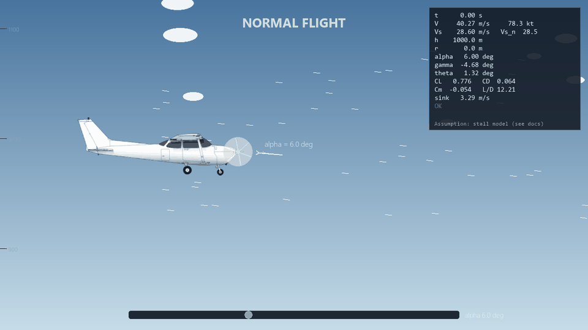

# Cessna 172 Glide & Stall Simulator

A 2D side-view engineering test of a Cessna 172 after the engine fails. The only control is angle of attack. This is not a game: there is no score, landing, or crash.



## Features

- Homework aerodynamics: \(C_L\), \(C_D\), and \(C_m\) versus angle of attack, and \((L/D)_\max\).
- Equilibrium glide speed and flight-path angle, used as the initial state and plotted against altitude.
- Point-mass longitudinal integration with SciPy `RK23` (`solve_ivp`).
- Interactive glide: the sprite pitch is \(\theta = \alpha + \gamma\), so the nose can sit above the horizon while the airplane descends.
- A labeled stall model, stall speed, and a log of stall onset and recovery.
- Live dashboard, then engineering plots and a CSV export.

## Physics in one paragraph

Lift and drag come from \(C_L = 0.20 + 0.096\alpha\) (degrees) and \(C_D = 0.032 + 0.0524 C_L^2\), until the stall break. With thrust zero, \(\dot V = -D/m - g\sin\gamma\) and \(\dot\gamma = (L - mg\cos\gamma)/(mV)\). Altitude and range follow \(V\sin\gamma\) and \(V\cos\gamma\). Steady glide gives \(\gamma = -\arctan(C_D/C_L)\) and the matching speed. \(C_m\) is shown and plotted only. Defaults are \(m = 1156.7\) kg, \(S = 16.165\) m\(^2\), and the ISA troposphere density in the specification. Change them in `src/cessna_sim/config.py`. The startup line prints the values in use.

## Install

Python 3.10 or newer.

```bash
python -m venv .venv
.venv\Scripts\activate
pip install -e ".[dev]"
```

## Run

```bash
python -m cessna_sim
```

`python main.py` does the same thing.

Homework figures 1–4, without the window:

```bash
python -m cessna_sim --hw
```

Figures land in `outputs/hw_YYYYMMDD_HHMMSS/`.

## Controls

On the setup screen, set initial altitude (50 to 5000 m, default 1000), initial angle of attack (−2 to 20 deg, default 6), and the time limit (default 300 s). Speed and flight-path angle are computed. **Glide test** is interactive. **HW part (d)** integrates 0 to 10 s from 10 m at constant angle of attack and opens the results.

After a few seconds of level flight the engine stops. Up and down arrows change angle of attack at 4 deg/s. The slider does the same. The run ends at 10 m altitude, at the time limit, or if speed falls to 0.5 m/s. There is no landing.

`D` toggles a geometry overlay: center of gravity, fuselage line, velocity line, horizon, and the true and drawn pitch angles.

## Outputs

**Show plots** opens the five figures. **Export** writes 300 dpi PNGs plus `run.csv` and `events.csv` into `outputs/run_YYYYMMDD_HHMMSS/`. Stall onsets are marked on the time histories.

## Assumptions and limitations

- Point mass. No pitch inertia, so angle of attack changes in a step. Only the drawn pitch is eased (0.15 s). The numbers are not eased.
- \(C_m\) is not in the equations.
- The stall break and the 0.07 per degree post-stall slope are an assumption, marked on the dashboard. See `docs/theory.md`.
- With the default drag model, drag falls when lift falls after the stall. That is the homework polar, and it is not physical.
- No wind, flaps, ground effect, thrust, or propeller force.
- Mass, wing area, and the density model are the specification defaults until the homework statement replaces them.

## Tests

```bash
pytest
```

`docs/validation.md` lists the numerical checks.

## References

- Cessna 172S POH: https://calaero.edu/wp-content/uploads/2023/05/Cessna_172SP_NavIII_POH_opt.pdf
- NTSB 172S stall comparison: https://data.ntsb.gov/Docket/Document/docBLOB?FileExtension=.PDF&FileName=Comparison+Data+%28Cessna+172S+-+Altitude+Loss+During+Stalls+and+Spins%29-Master.PDF&ID=40374572
- Cessna 172P POH: https://txwg.cap.gov/media/cms/C172P_POH_wo_Supplements_AC5C148CF2BF0.pdf
- JSBSim c172p: https://github.com/JSBSim-Team/jsbsim/blob/master/aircraft/c172p/c172p.xml
- NACA 2412 XFOIL polar: http://airfoiltools.com/polar/details?polar=xf-naca2412-il-1000000
- Abbott and von Doenhoff, NACA Report 824: https://ntrs.nasa.gov/citations/19930092747
- Airfoil usage: https://m-selig.ae.illinois.edu/ads/aircraft.html
- FAA Pilot's Handbook of Aeronautical Knowledge: https://www.faa.gov/regulations_policies/handbooks_manuals/aviation/phak
- NASA Glenn atmosphere model: https://www.grc.nasa.gov/www/k-12/airplane/atmosmet.html

## Assets

The side view is "2004 Cessna 172S" by Er-Jin Jang, Wikimedia Commons, CC BY-SA 4.0. The drawn propeller is masked. The propeller in the view is procedural. Details are in `assets/ATTRIBUTION.md`. Code is MIT; the drawing is not.

## Author

Sahand — MSc Aerospace Engineering (Flight Dynamics & Control), University of Tehran.
